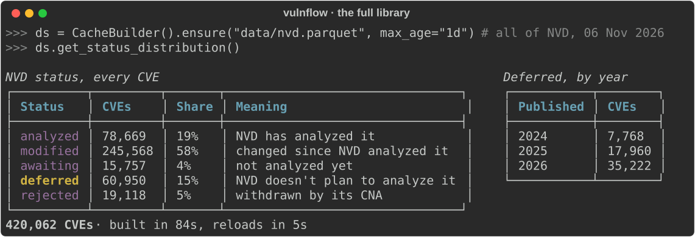
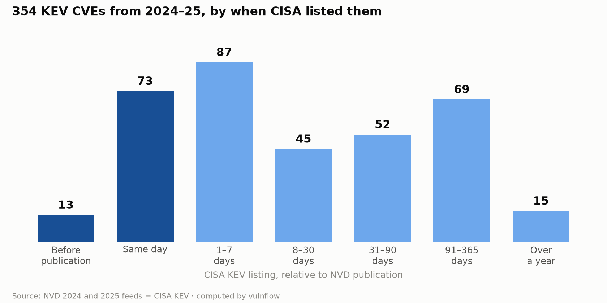
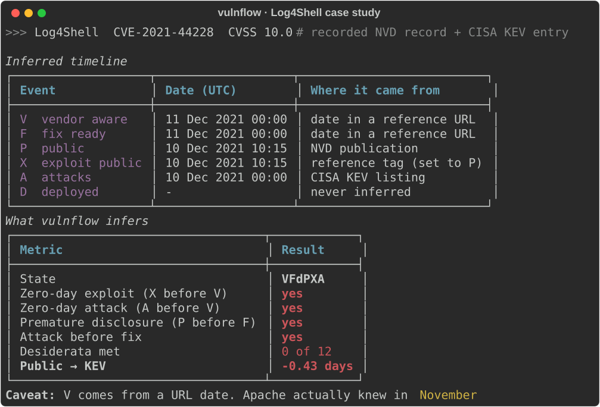
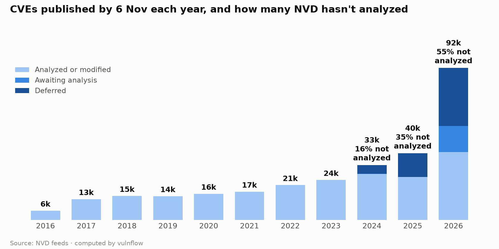

<h1 align="center">vulnflow</h1>

<p align="center">
  <b>Fast, boring ETL for public vulnerability data. NVD, CISA KEV, EPSS, CWE, CAPEC and Microsoft's Patch Tuesday feed, normalized into one columnar dataset for pandas, polars or Parquet.</b>
</p>

<p align="center">
  
  
  
  <a href="https://github.com/corifeo/vulnflow/actions/workflows/ci.yml"></a>
  
</p>

<p align="center">
  <a href="#installation">Install</a> ·
  <a href="#quick-start">Quick start</a> ·
  <a href="#the-full-library">Full library</a> ·
  <a href="#kev-timing-in-10-lines">Real-data KEV timing</a> ·
  <a href="#case-study-log4shell">Log4Shell case study</a> ·
  <a href="#case-study-the-2026-surge">The 2026 surge</a> ·
  <a href="#what-the-dates-mean">What the dates mean</a> ·
  <a href="#pipelines">Pipelines</a> ·
  <a href="#sources-and-outputs">Sources</a>
</p>

<p align="center">
  
</p>

If you've spent half a notebook cleaning CVE feeds before doing any analysis, vulnflow is for you. It moves public vulnerability data and makes it sane:

- **One line to a dataframe.** `CacheBuilder(recent_only=True).build().to_pandas()` pulls the last week of NVD with KEV, EPSS, CWE and flattened CVSS in seconds. All of NVD takes about two minutes.
- **Columnar all the way.** Data lives in NumPy arrays, not record objects. CVD event inference and state for 83,000 CVEs takes under three seconds.
- **Explicit pipelines.** Extractors, transforms and loaders run exactly as you list them, in dependency order. A missing dependency is reported, not silently skipped.
- **Typed and tested.** `py.typed`, `mypy --strict`, about 1,200 tests on Python 3.11 to 3.14.

The pipeline core has no risk scoring and no opinions. `vulnflow.helpers.explore` adds optional helpers such as `risk_priority()`; treat them as a starting point, not a policy.

## Installation

vulnflow isn't on PyPI yet. Install it from GitHub:

```bash
uv add git+https://github.com/corifeo/vulnflow
```

```bash
pip install git+https://github.com/corifeo/vulnflow
```

From source, with the example notebooks and Jupyter:

```bash
git clone https://github.com/corifeo/vulnflow && cd vulnflow
uv sync --extra notebook
```

Requires Python 3.11+. HTTP responses are cached under `.cache/` in the working directory.

## Quick start

```python
from vulnflow.helpers import CacheBuilder

df = CacheBuilder(recent_only=True).build().to_pandas()
```

That's NVD's Recent feed, the CVEs published in the last eight days, with KEV, EPSS, CWE and CPE already joined and CVSS flattened. The screenshot above is this exact call on 6 November 2026: 3,681 CVEs and 47 columns in a few seconds. The 11% CPE figure is real: NVD's analysis backlog means most new CVEs have no product data yet.

## The full library

Once you know what's in the data, build all of it:

```python
from vulnflow.helpers import CacheBuilder

ds = CacheBuilder().ensure("data/nvd.parquet", max_age="1d")
```

That's every CVE NVD has published, 2002 to today, with the same enrichment. The first call downloads all the yearly feeds and builds the library in about two minutes; after that it reloads from Parquet until the file is a day old.

**Feed a warehouse.** `data/nvd.parquet` is the hand-off: one row per CVE, timestamps in UTC, and nested fields such as references and CPE matches as JSON strings. In Snowflake, for example, `PUT` the file to a stage and `COPY INTO` a table with `MATCH_BY_COLUMN_NAME`; `PARSE_JSON` turns the JSON columns into `VARIANT`.

**Ask it a question.** How many CVEs has NVD deferred, meaning it doesn't plan to analyze them?

```python
ds.get_status_distribution()   # {'analyzed': 78669, 'awaiting': 15757, 'deferred': 60950, ...}

deferred = ds.to_pandas(analyzed=False, modified=False, awaiting=False)
deferred["nvd_published_at"].dt.year.value_counts().sort_index()
```

<p align="center">
  
</p>

On 6 November 2026, 60,950 CVEs (15%) were Deferred, and every one of them was published in 2024 or later: NVD is deferring new CVEs, not old ones. `to_pandas()` skips rejected CVEs unless you pass `rejected=True`.

## KEV timing in 10 lines

How often does CISA list a CVE as exploited before NVD has even published it? Two years of NVD, joined with the KEV catalog:

```python
import numpy as np
from vulnflow.helpers import CacheBuilder
from vulnflow.transforms.computed import CVDStateTransform
from vulnflow.transforms.inferences import EventInference

ds = CacheBuilder(years=[2024, 2025]).ensure("data/library.parquet", max_age="7d")
kev = ds.filter(np.array([bool(x) for x in ds.get_column("is_kev")]))
kev.transform([EventInference(), CVDStateTransform()])

(kev.get_column("public_to_attack_days") <= 0).mean()   # 0.24
```

`ensure()` builds the library once and reloads it from Parquet while it's fresh.

<picture>
  <source media="(prefers-color-scheme: dark)" srcset=".github/assets/kev_timing_dark.png">
  
</picture>

Of the 354 CVEs from 2024 and 2025 in KEV, 86 (24%) were listed on or before the day NVD published them. That figure needs only two dates every source agrees on, which brings us to the caveat in [What the dates mean](#what-the-dates-mean). Every number above comes from real data; [`scripts/make_readme_assets.py`](scripts/make_readme_assets.py) regenerates it.

## Case study: Log4Shell

```python
from vulnflow import VulnPipeline
from vulnflow.extractors import NVDAPIExtractor
from vulnflow.transforms.computed import CVDStateTransform
from vulnflow.transforms.enrichers import KEVEnricher
from vulnflow.transforms.flatten import KEVFlattenTransform
from vulnflow.transforms.inferences import EventInference

result = VulnPipeline(
    extractors=[NVDAPIExtractor(cve_id="CVE-2021-44228")],
    transformers=[KEVEnricher(), KEVFlattenTransform(), EventInference(), CVDStateTransform()],
).run()
row = result.dataset.to_pandas().iloc[0]

row.cvd_state              # 'VFdPXA': vendor aware, fix ready, public, exploit, attacks
row.is_zero_day_attack     # True: in KEV before the earliest vendor date vulnflow found
row.public_to_attack_days  # -0.43: CISA listed it the day NVD published it
```

<p align="center">
  
</p>

[`tests/integration/test_log4shell.py`](tests/integration/test_log4shell.py) pins these values against a recorded NVD record, and the screenshot comes from the same record.


## Case study: the 2026 surge

Is NVD keeping up? Count the CVEs published by the same date each year, using the full library:

```python
from vulnflow.helpers import CacheBuilder

df = CacheBuilder().ensure("data/nvd.parquet", max_age="1d").to_pandas()
window = df[df["nvd_published_at"].dt.strftime("%m-%d") <= "11-06"]   # 1 Jan to 6 Nov
window.groupby(window["nvd_published_at"].dt.year).agg(
    cves=("cve_id", "size"),
    not_analyzed=("nvd_status", lambda s: s.isin(["awaiting", "deferred"]).mean()),
)
```

<picture>
  <source media="(prefers-color-scheme: dark)" srcset=".github/assets/volume_dark.png">
  
</picture>

- **Volume more than doubled.** By 6 November, NVD had published 92,067 CVEs in 2026, against 40,343 by the same date in 2025: 2.3 times as many, after growth of under 40% a year since 2018. Monthly volume climbed from 4,302 in January to 17,058 in October.
- **Analysis is falling behind.** Until 2023, NVD had analyzed virtually every CVE published by 6 November. The share it hasn't, counting both Awaiting Analysis and Deferred, went from 16% of 2024's CVEs to 35% of 2025's and 55% of 2026's.
- **Most of the gap won't close.** Of 2026's 50,936 unanalyzed CVEs, 35,222 are Deferred, meaning NVD doesn't plan to analyze them; 15,714 are still awaiting. Only 45% of 2026's CVEs carry product (CPE) data, against 100% of 2023's.

If you match CVEs to your own products, that last point matters more than the headline count: for most new CVEs, NVD won't tell you what's affected.

## What the dates mean

CVD analytics compare six event dates: vendor aware (V), fix ready (F), fix deployed (D), public (P), exploit public (X) and attacks seen (A).

- **Only P and A are source dates.** P is NVD's publication date and A is the KEV listing date. Public feeds don't say when a vendor learned about a bug.
- **V, F and X are inferred** from NVD reference tags and dates in reference URLs, so they can be wrong. Log4Shell's V comes out as 11 December 2021; Apache actually knew in November.
- **Some events are filled in from others.** With no exploit date, X takes the KEV date; with no vendor date but a fix date, V takes the fix date. D (fix deployed) is never inferred, so the state always shows `d`.
- **No V means unknown, not unaware.** It shows as `v` in the state, and zero-day flags stay `False` rather than guessing.
- **Date-only sources sort first.** KEV and URL dates are midnight UTC, so a same-day KEV listing counts as before a 10:15 publication. A KEV date means attacks were already seen by that day.

`public_to_attack_days <= 0` is the most robust signal here, because it uses only P and A.

## Pipelines

```python
from vulnflow import VulnPipeline
from vulnflow.extractors import NVDExtractor
from vulnflow.helpers import CacheBuilder
from vulnflow.loaders import ParquetLoader
from vulnflow.transforms.computed import CVDStateTransform
from vulnflow.transforms.enrichers import KEVEnricher
from vulnflow.transforms.flatten import KEVFlattenTransform
from vulnflow.transforms.inferences import EventInference

pipeline = VulnPipeline(
    extractors=[NVDExtractor(CacheBuilder.feed_url(2025))],
    transformers=[KEVEnricher(), KEVFlattenTransform(), EventInference(), CVDStateTransform()],
    loaders=[ParquetLoader("nvd-2025.parquet")],
)
result = pipeline.run()

result.errors              # failed stages; the run continues past them unless strict=True
result.dataset.to_pandas()
```

Transforms run in phases computed from their `depends_on`. Pipelines compose: `extract.merge(enrich)` combines stages, `VulnPipeline.chain([...])` merges a list. `VulnDataset.transform()` with no arguments runs the registry defaults, for notebooks.

## Triage queue export

`TriageLoader` turns a dataset into a ranked queue for an SSVC triage tool such as VulnTriage: KEV CVEs first, then by EPSS and CVSS, capped at 500 by default.

```python
from vulnflow.helpers import CacheBuilder
from vulnflow.loaders import TriageLoader

ds = CacheBuilder(recent_only=True).build()
TriageLoader("data/triage-queue.json", min_epss=0.01).load(ds)
```

Each item carries suggested SSVC values with the reason for each. They are heuristics for an analyst to confirm:

- **Exploitation:** `active` if in KEV (or CVSS v4 E:A), `poc` if NVD tags a reference as Exploit (or E:P), else `none`.
- **Automatable:** `yes` only with AV:N, AC:L, PR:N and UI:N (CVSS v4's AU metric wins when present).
- **Technical impact:** `total` with high confidentiality and integrity impact, else `partial`.

Mission and well-being are yours to set: no public feed knows your assets.

## Sources and outputs

| Stage | Available |
|---|---|
| Extract | NVD JSON feeds (files or URLs), NVD REST API 2.0, MSRC CVRF (Patch Tuesday), Parquet, JSON, pandas, polars |
| Enrich | CISA KEV, EPSS, CWE, CAPEC, NVD change history |
| Flatten | CVSS (v2, v3.x, v4), CPE, CWE, CAPEC, KEV, EPSS, STRIDE, MSRC |
| Infer | CVD event timestamps, tags, STRIDE categories |
| Compute | CVD state, zero-day and exposure flags, desiderata, time deltas |
| Load | Parquet, JSON, pandas, polars, SSVC triage queue (JSON) |

Extractors live in `vulnflow.extractors`, loaders in `vulnflow.loaders`, and transforms in `vulnflow.transforms.enrichers`, `.flatten`, `.inferences` and `.computed`.

## Examples & notebooks

| | |
|---|---|
| [`01-first-look.ipynb`](examples/01-first-look.ipynb) | the first five minutes: Recent feed to pandas |
| [`02-build-library.ipynb`](examples/02-build-library.ipynb) | a persistent Parquet library with incremental updates |
| [`03-weekly-triage.ipynb`](examples/03-weekly-triage.ipynb) | a Monday triage of what changed this week |
| [`04-patch-tuesday.ipynb`](examples/04-patch-tuesday.ipynb) | NVD API queries and Microsoft Patch Tuesday |
| [`05-threat-landscape.ipynb`](examples/05-threat-landscape.ipynb) | trends and charts across 2024 and 2025 |
| [`06-custom-pipeline.ipynb`](examples/06-custom-pipeline.ipynb) | building and composing `VulnPipeline`s |
| [`examples/scripts/`](examples/scripts/) | cron refresh, a KEV alert, a CI pipeline |

Setup and troubleshooting: [`examples/README.md`](examples/README.md).

## Related

[vulnstate](https://github.com/corifeo/vulnstate) models a single CVE's disclosure lifecycle as a state machine. vulnflow is the data pipeline: it computes the same CVD state at scale from public feeds.

## Development

```bash
uv sync
uv run pytest
uv run ruff check src/ tests/
uv run mypy src/ --strict
uv run black --check src/ tests/
uv run --with rich --extra notebook python scripts/make_readme_assets.py   # regenerate README images
```

Issues and PRs are welcome, especially new extractors and enrichers. Each one is a small class; see the existing ones in `src/vulnflow/`.

## Citation

To cite vulnflow, use **Cite this repository** on GitHub ([`CITATION.cff`](CITATION.cff)).

## Data sources and notices

vulnflow downloads data at run time from its publishers; it ships none of it. Each source's terms apply to what you download.

- This product uses data from the NVD API but is not endorsed or certified by the NVD.
- CISA Known Exploited Vulnerabilities catalog, from the Cybersecurity and Infrastructure Security Agency.
- EPSS scores from FIRST and Empirical Security.
- CWE and CAPEC are trademarks of The MITRE Corporation.
- Microsoft Security Response Center CVRF API.

## License

[MIT](LICENSE)
